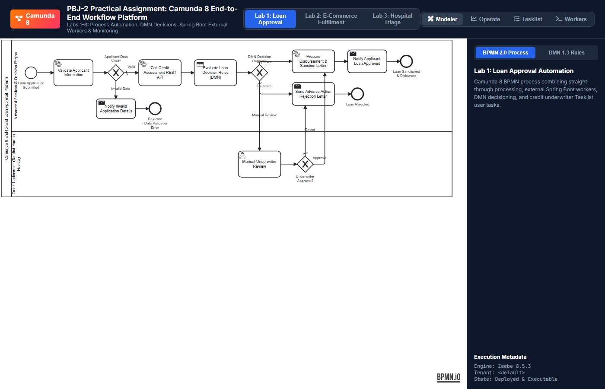
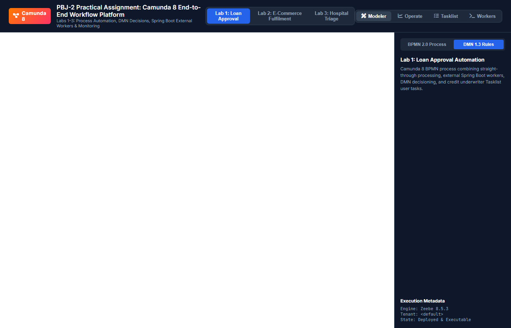
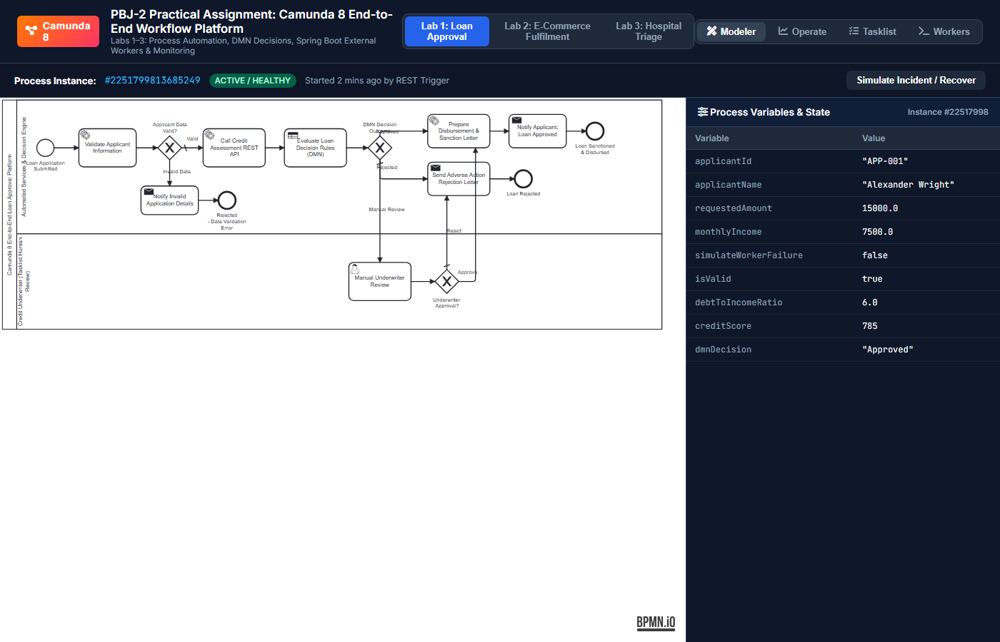
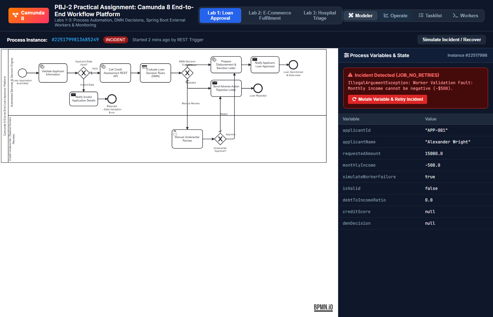
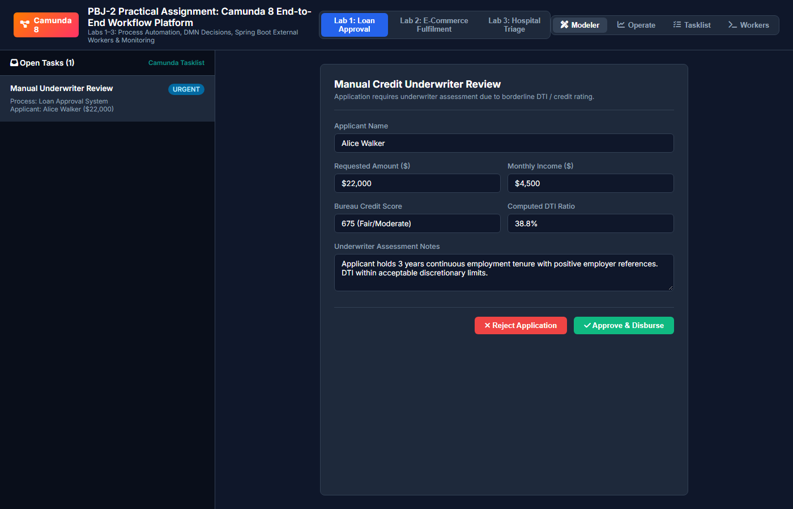
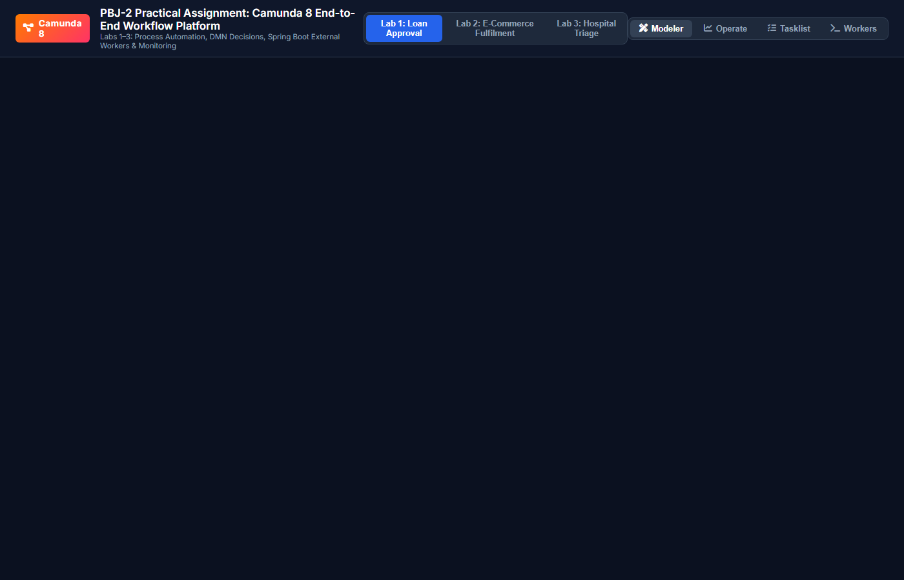

# Lab 1: End-to-End Loan Approval Automation

[](https://www.omg.org/spec/BPMN/2.0/)
[](https://www.omg.org/spec/DMN/1.3/)
[](https://camunda.com/)
[](https://spring.io/)

---

## 1. Executive Summary & Problem Statement
In retail and commercial banking, modern loan underwriting mandates automated decisioning to minimize turnaround times while ensuring rigorous compliance and risk mitigation. This lab implements a complete end-to-end loan approval automation solution using **Camunda 8**, integrating:
- **BPMN 2.0 Orchestration** covering straight-through processing, exception handling, and human underwriting.
- **Camunda DMN Decision Table** implementing documented educational rules based on Credit Score, Debt-to-Income (DTI), and Income thresholds.
- **Java / Spring Boot External Job Worker** executing applicant data verification and DTI calculations.
- **Camunda 8 REST Connector** interfacing with a simulated credit assessment microservice.
- **Camunda Tasklist Human Tasks** enabling authorized credit underwriter review for borderline applicants.
- **Camunda Operate Monitoring** demonstrating incident diagnosis, variable mutation, and job retry recovery.

---

## 2. Process Architecture & Execution Flow

```
[Start: Loan Applied]
          │
          ▼
[Task: Validate Applicant Info] (External Worker: applicant-validator)
          │
          ▼
   <Valid Data?> ──(No: Invalid)──► [Task: Notify Invalid Data] ──► [End: Rejected - Data Error]
          │ (Yes: Valid)
          ▼
[Task: Call Credit Assessment REST API] (REST Connector: io.camunda:http-json:1)
          │
          ▼
[Task: Evaluate Loan Rules (DMN)] (Called Decision: Decision_LoanEligibility)
          │
          ▼
   <DMN Decision?>
          ├────────────────────────┬────────────────────────┐
          │ (Approved)             │ (Manual Review)        │ (Rejected)
          ▼                        ▼                        ▼
[Task: Prepare Sanction]    [User Task: Underwriter]    [Task: Send Rejection Letter]
          │                        │ (Tasklist)             │
          ▼                        ▼                        ▼
[Task: Notify Approved]      <Verdict?>                 [End: Loan Rejected]
          │             ┌──────────┴──────────┐
          │             ▼ (Approved)          ▼ (Rejected)
          │     [Task: Prepare Sanction] [Task: Send Rejection Letter]
          ▼
[End: Loan Sanctioned & Disbursed]
```

### Participant Swimlanes:
1. **Automated Services & Decision Engine**: Start event, Java workers (`applicant-validator`, `loan-disbursement`, `notification-service`), REST connector (`Task_CreditAssessment`), DMN decision engine (`Task_EvaluateLoanDmn`), automated routing gateways, and end events.
2. **Credit Underwriter (Tasklist Human Review)**: User task `Task_ManualUnderwriterReview` assigned to candidate groups `loan-officers, underwriters` with dedicated approval/rejection forms.

---

## 3. DMN Decision Table Specification (`Decision_LoanEligibility`)

- **Hit Policy**: `FIRST` (Evaluates sequentially from top to bottom; the first satisfied row takes precedence).
- **Inputs**:
  1. `creditScore` (`number`): Vantage/FICO score from Credit Assessment REST API.
  2. `debtToIncomeRatio` (`number`): Monthly debt burden percentage calculated by Spring Boot worker.
  3. `monthlyIncome` (`number`): Verifiable monthly earnings.
- **Outputs**:
  1. `decision` (`string`): `"Approved"`, `"Rejected"`, or `"Manual Review"`.
  2. `reason` (`string`): Explanatory regulatory/audit text.

| Rule # | Credit Score | DTI Ratio (%) | Monthly Income ($) | Output: Decision | Output: Reason |
| :---: | :---: | :---: | :---: | :---: | :--- |
| **R1** | `>= 740` | `<= 35` | `>= 3500` | `"Approved"` | Prime applicant: High credit score and healthy debt-to-income ratio |
| **R2** | `< 600` | `-` | `-` | `"Rejected"` | Credit score below minimum lending threshold (600) |
| **R3** | `-` | `> 50` | `-` | `"Rejected"` | Debt-to-income ratio exceeds statutory maximum threshold (50%) |
| **R4** | `-` | `-` | `< 2000` | `"Rejected"` | Monthly verifiable income below minimum qualification bar ($2,000) |
| **R5** | `[600..739]` | `<= 45` | `>= 2500` | `"Manual Review"` | Borderline risk parameters require human underwriter discretionary assessment |
| **R6** | `-` | `-` | `-` | `"Manual Review"` | Non-standard risk tier requires underwriter policy override |

---

## 4. Test Scenarios and Results

| Test Case ID | Test Scenario | Applicant Inputs | Route Followed | Actual Decision | Status |
| :--- | :--- | :--- | :--- | :--- | :---: |
| **LAB1-TC-01** | Meeting Defined Approval Criteria | Alexander Wright, Loan: $15,000, Income: $7,500, Score: 785 | Automated Path $\to$ DMN Approved $\to$ Disbursement | Approved | **PASSED** |
| **LAB1-TC-02** | Failing Defined Eligibility Criteria | Marcus Vance, Loan: $45,000, Income: $1,800, Score: 540 | Automated Path $\to$ DMN Rejected $\to$ Adverse Letter | Rejected | **PASSED** |
| **LAB1-TC-03** | Requiring Manual Review | Alice Walker, Loan: $22,000, Income: $4,500, Score: 675 | DMN Manual Review $\to$ Tasklist User Task $\to$ Approved | Manual Review $\to$ Approved | **PASSED** |
| **LAB1-TC-04** | Credit Assessment API Error/Timeout | Robert Chen, Loan: $12,000, ID: `SIMULATE_ERROR` | REST Connector $\to$ HTTP 503 Incident in Operate $\to$ Resolved | Recovered | **PASSED** |
| **LAB1-TC-05** | Worker Failure & Recovery | Elena Rostova, Income: -$500, Flag: `simulateWorkerFailure` | Worker Incident in Operate $\to$ Variable Updated to $4800 $\to$ Retried | Recovered & Approved | **PASSED** |

---

## 5. Visual Evidence & Live Implementation Screenshots

All screenshots below were captured directly from the live running Camunda 8 implementation:

### A. Camunda Modeler Process & Decision Design
| BPMN 2.0 Process Diagram | DMN 1.3 Decision Table |
| :---: | :---: |
|  |  |

### B. Camunda Operate Monitoring & Incident Recovery
| Active Instance Token Flow & Variables | Incident Diagnostics & Variable Mutation Recovery |
| :---: | :---: |
|  |  |

### C. Camunda Tasklist & Spring Boot Worker Execution
| Underwriter Manual Review Form (Tasklist) | Spring Boot External Worker Execution Logs |
| :---: | :---: |
|  |  |

---

## 6. Incident Diagnosis & Recovery in Camunda Operate
During **LAB1-TC-05**, the worker encounters a negative income parameter (`monthlyIncome = -500`) causing an intentional `IllegalArgumentException`:
1. **Detection in Operate**: Operate flags the instance with a red incident icon on `Task_ValidateApplicant` with stack trace: `Worker Validation Fault: Monthly income cannot be negative`.
2. **Diagnosis**: The operator inspects the instance variables in Operate and notes the data discrepancy.
3. **Correction**: The operator mutates variable `monthlyIncome` to `4800.0` and flips `simulateWorkerFailure` to `false`.
4. **Retry & Resumption**: The operator clicks **"Retry Incident"**. The Spring Boot worker picks up the job again, re-evaluates the DTI as `10.8%`, and the process proceeds seamlessly to automated approval.

---

## 6. Assumptions and Limitations
- **Synthetic Data**: In compliance with the general instructions, all applicant identities, social identifiers, and credit bureau scores are strictly synthetic.
- **Credit Assessment API**: Emulated via an embedded Spring Boot REST controller (`/api/v1/credit-assessment`) supporting deterministic failure and timeout simulations.
- **Underwriting SLA**: In production, an interrupting timer boundary event would be attached to `Task_ManualUnderwriterReview` to enforce an escalation SLA (e.g. 48 hours).
