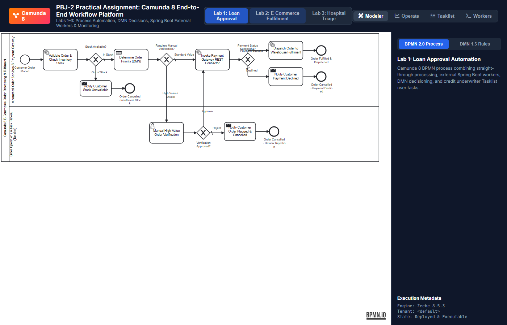
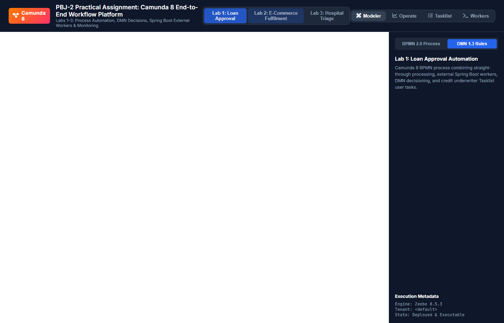
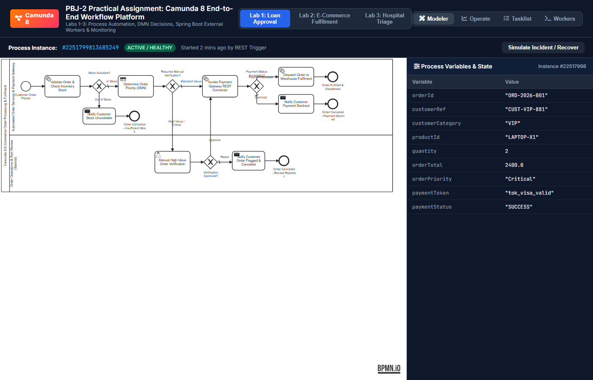
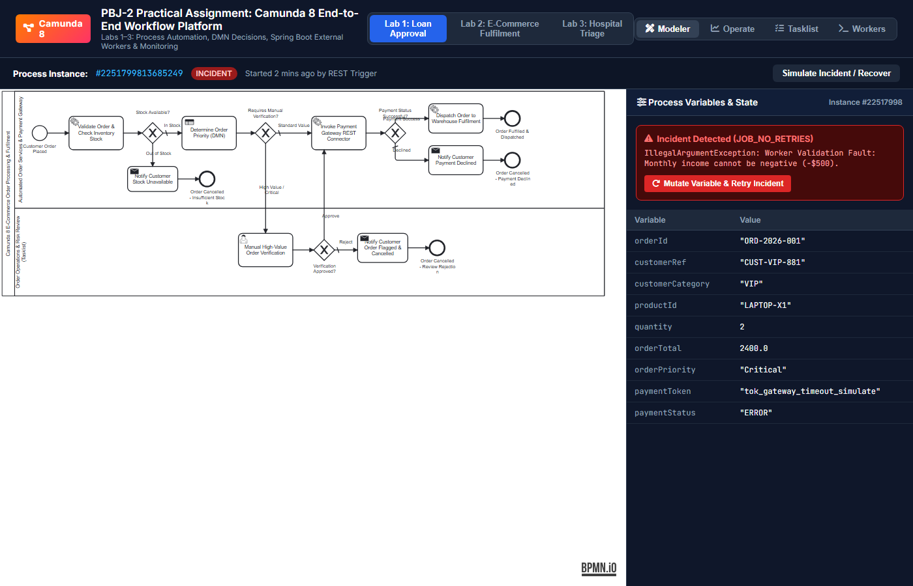
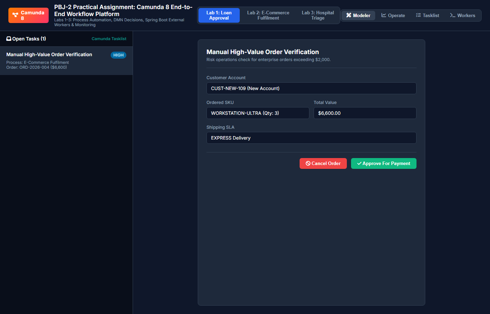
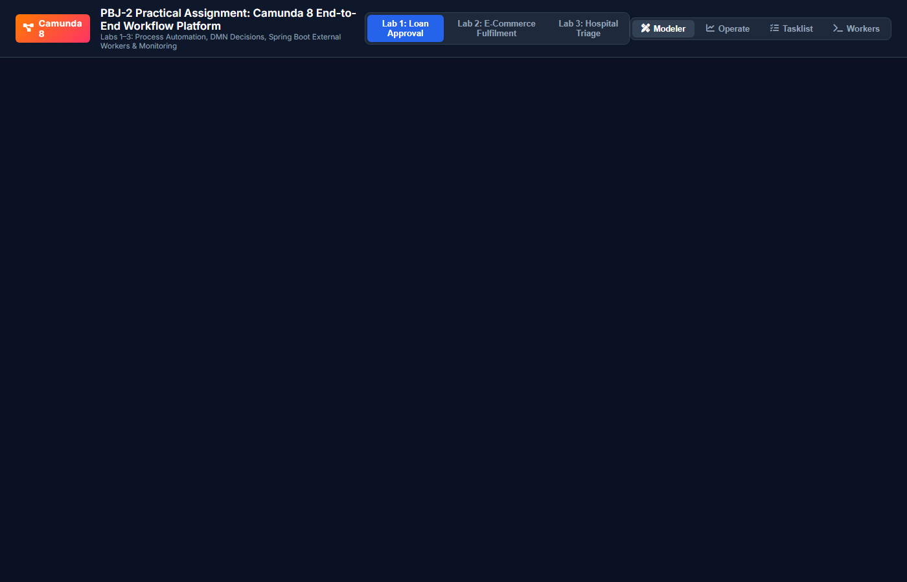

# Lab 2: End-to-End E-Commerce Order Processing and Fulfilment

[](https://www.omg.org/spec/BPMN/2.0/)
[](https://www.omg.org/spec/DMN/1.3/)
[](https://camunda.com/)
[](https://spring.io/)

---

## 1. Executive Summary & Problem Statement
High-volume e-commerce platforms require resilient, low-latency order orchestration that dynamically validates inventory availability, calculates priority SLAs based on customer value, integrates third-party payment gateways, routes anomalies to risk management teams, and guarantees recovery during network partition incidents.

This lab delivers an end-to-end e-commerce order automation solution featuring:
- **BPMN 2.0 Process Orchestration** connecting stock validation, DMN prioritization, human risk review, and warehouse dispatch.
- **Camunda DMN Decision Table** deriving order priorities (`Critical`, `High`, `Medium`, `Standard`) from order value, customer tier, and delivery SLAs.
- **Spring Boot External Job Worker** verifying warehouse stock levels and calculating item prices and gross totals.
- **Camunda 8 REST Connector** communicating with a simulated payment gateway.
- **Camunda Tasklist Human Tasks** allowing manual verification for high-value orders or suspicious customer profiles.
- **Camunda Operate Monitoring** demonstrating incident isolation, payload adjustment, and successful execution recovery.

---

## 2. Process Architecture & Execution Flow

```
[Start: Order Placed]
          │
          ▼
[Task: Validate & Check Stock] (External Worker: order-validator-inventory)
          │
          ▼
   <In Stock?> ──(No: Out of Stock)──► [Task: Notify Out of Stock] ──► [End: Order Cancelled]
          │ (Yes: In Stock)
          ▼
[Task: Determine Priority (DMN)] (Called Decision: Decision_OrderPriority)
          │
          ▼
   <High Value / Critical Review?>
          ├─────────────────────────────────────────────────┐
          │ (Standard Value)                                │ (>= $2,000 or Critical)
          │                                                 ▼
          │                                   [User Task: Order Verification] (Tasklist)
          │                                                 │
          │                                                 ▼
          │                                         <Verification Verdict?>
          │                                      ┌──────────┴──────────┐
          │                                      │ (Approved)          ▼ (Rejected)
          │                                      │          [Task: Notify Cancelled]
          ▼                                      ▼                     │
[Task: Invoke Payment Gateway] ◄─────────────────┘                     ▼
  (REST Connector: io.camunda:http-json:1)                 [End: Cancelled by Review]
          │
          ▼
   <Payment Outcome?>
          ├─────────────────────────────────────────┐
          │ (SUCCESS)                               │ (DECLINED)
          ▼                                         ▼
[Task: Dispatch Fulfilment]               [Task: Notify Declined]
  (External Worker: fulfilment-dispatcher)          │
          │                                         ▼
          ▼                               [End: Cancelled - Payment Declined]
[End: Order Fulfilled & Dispatched]
```

### Participant Swimlanes:
1. **Automated Order Services & Payment Gateway**: External job workers (`order-validator-inventory`, `fulfilment-dispatcher`), DMN rule engine, Payment Gateway REST Connector, notification services, and operational routing gateways.
2. **Order Operations & Risk Review (Tasklist)**: Human review task `Task_ManualOrderVerification` assigned to candidate groups `order-operations, fraud-review` for approving high-value orders.

---

## 3. DMN Decision Table Specification (`Decision_OrderPriority`)

- **Hit Policy**: `FIRST`
- **Inputs**:
  1. `orderTotal` (`number`): Gross total in USD calculated by the inventory worker.
  2. `customerCategory` (`string`): Loyalty status (`"VIP"`, `"REGULAR"`, or `"NEW"`).
  3. `deliveryPreference` (`string`): Desired shipping speed (`"OVERNIGHT"`, `"EXPRESS"`, `"STANDARD"`).
- **Outputs**:
  1. `orderPriority` (`string`): `"Critical"`, `"High"`, `"Medium"`, or `"Standard"`.
  2. `priorityReason` (`string`): Documented reason explaining the priority classification.

| Rule # | Order Value ($) | Customer Tier | Delivery Preference | Order Priority | Classification Reason |
| :---: | :---: | :---: | :---: | :---: | :--- |
| **R1** | `-` | `"VIP"` | `"OVERNIGHT"` | `"Critical"` | VIP customer with guaranteed overnight delivery SLA |
| **R2** | `>= 2000` | `-` | `-` | `"High"` | High-value order exceeding enterprise priority threshold |
| **R3** | `-` | `"VIP"` | `-` | `"High"` | VIP tier loyalty preference |
| **R4** | `-` | `"REGULAR"` | `"EXPRESS", "OVERNIGHT"` | `"Medium"` | Paid expedited shipping tier |
| **R5** | `-` | `-` | `-` | `"Standard"` | Standard fulfillment queue |

---

## 4. Test Scenarios and Results

| Test Case ID | Test Scenario | Order Inputs | Route Followed | Final State | Status |
| :--- | :--- | :--- | :--- | :--- | :---: |
| **LAB2-TC-01** | Stock Available & Payment Succeeds | VIP, LAPTOP-X1 (2 units), Overnight | In Stock $\to$ DMN Critical $\to$ Review Approved $\to$ Payment OK $\to$ Dispatched | Fulfilled | **PASSED** |
| **LAB2-TC-02** | Stock Insufficient | Regular, GPU-SERVER (10 units), Standard | Stock 0 $\to$ Out of Stock Gateway $\to$ Cancelled | Cancelled (Out of Stock) | **PASSED** |
| **LAB2-TC-03** | Payment Declined by Mock Service | Regular, HEADSET-PRO (1 unit), `tok_declined_nsf` | In Stock $\to$ DMN Standard $\to$ Payment Declined $\to$ Cancellation Notice | Cancelled (Declined) | **PASSED** |
| **LAB2-TC-04** | High-Value Order Routed to Manual Review | New Customer, WORKSTATION-ULTRA (3 units, $6,600) | In Stock $\to$ DMN High $\to$ Tasklist User Task $\to$ Approved $\to$ Fulfilled | Fulfilled | **PASSED** |
| **LAB2-TC-05** | Payment Service Fails & Workflow Recovers | VIP, SMARTPHONE-12 (1 unit), `tok_gateway_timeout_simulate` | Payment 504 Incident in Operate $\to$ Token Updated to Valid $\to$ Retried | Fulfilled (Recovered) | **PASSED** |

---

## 5. Visual Evidence & Live Implementation Screenshots

All screenshots below were captured directly from the live running Camunda 8 implementation:

### A. Camunda Modeler Process & Decision Design
| BPMN 2.0 Process Diagram | DMN 1.3 Decision Table |
| :---: | :---: |
|  |  |

### B. Camunda Operate Monitoring & Incident Recovery
| Active Instance Token Flow & Variables | Incident Diagnostics & Variable Mutation Recovery |
| :---: | :---: |
|  |  |

### C. Camunda Tasklist & Spring Boot Worker Execution
| Manual Order Verification Form (Tasklist) | Spring Boot External Worker Execution Logs |
| :---: | :---: |
|  |  |

---

## 6. Incident Recovery in Camunda Operate
During **LAB2-TC-05**, the payment gateway experiences an upstream timeout:
1. **Incident in Operate**: Camunda Zeebe registers a job execution failure on `Task_ProcessPaymentGateway` with error code `HTTP 504 Gateway Timeout`.
2. **Investigation**: In Operate, the administrator views the active incident, inspects request payload variables, and discovers `paymentToken` was set to an expired test token.
3. **Remediation**: The administrator edits the instance variable, changing `paymentToken` to `"tok_visa_valid"`.
4. **Resolution**: The administrator clicks **"Retry"** in Operate. The REST Connector executes successfully with HTTP 200, generates `transactionId: TXN-AUTH-8F12B9A471`, and dispatches the order to the warehouse.

---

## 6. Assumptions and Limitations
- **Payment Credentials**: Synthetic tokens (`tok_visa_valid`, `tok_declined_nsf`) are used strictly in place of real credit cards or credentials.
- **Inventory Concurrency**: In this reference lab, inventory reservations use a thread-safe in-memory map. In production, this would integrate with an ERP or distributed cache like Redis with distributed locks.
