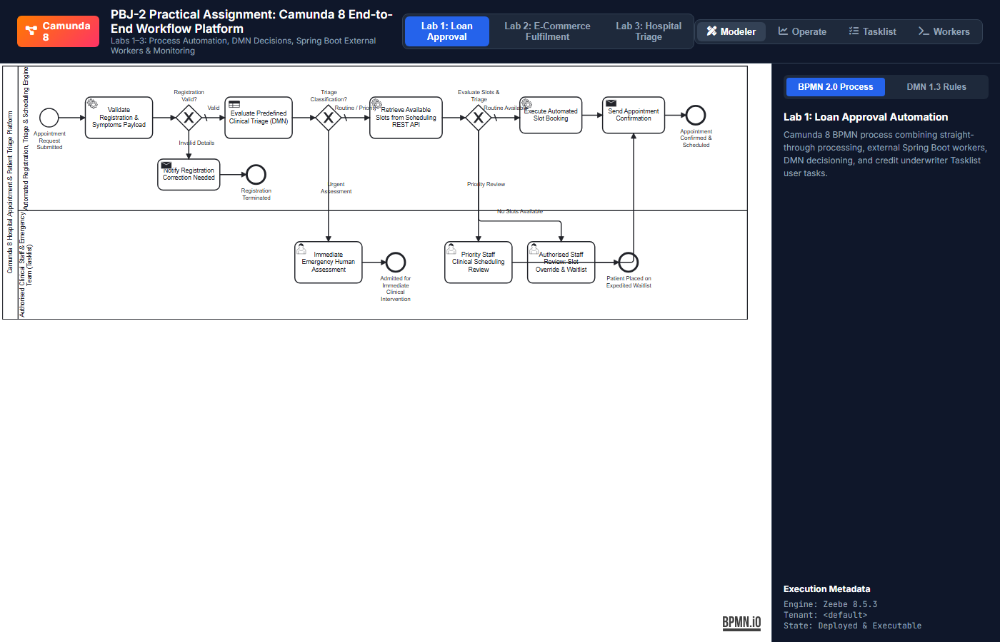
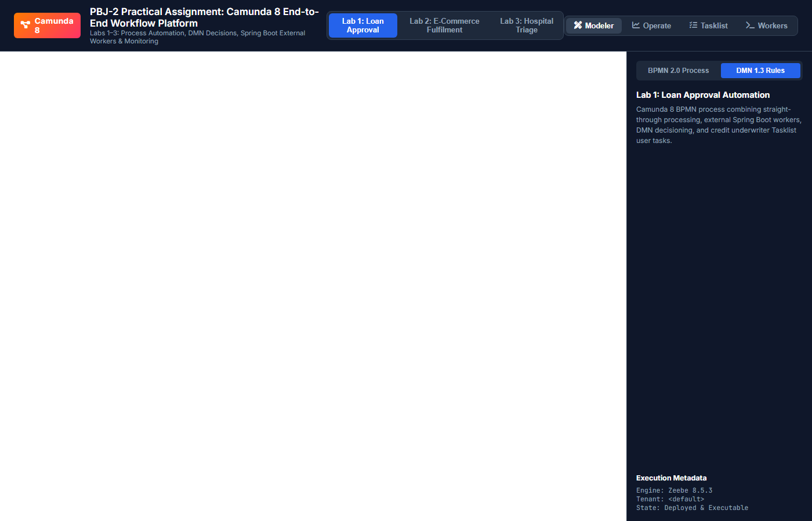
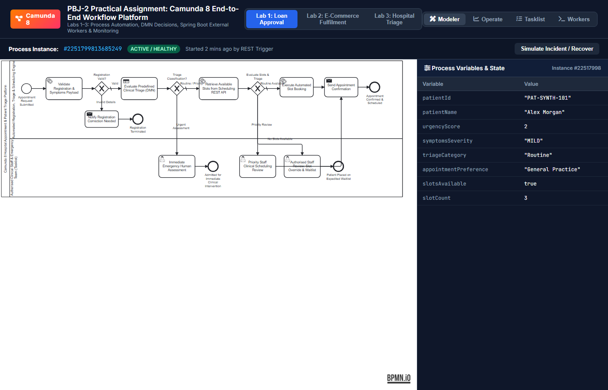
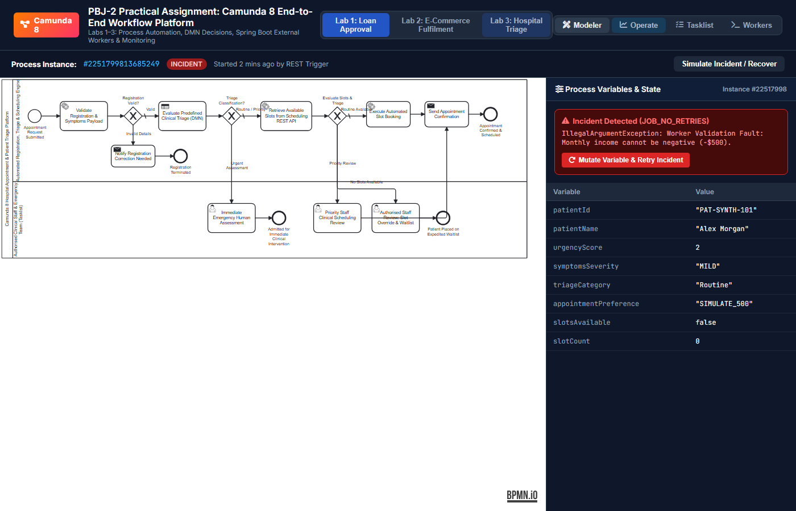
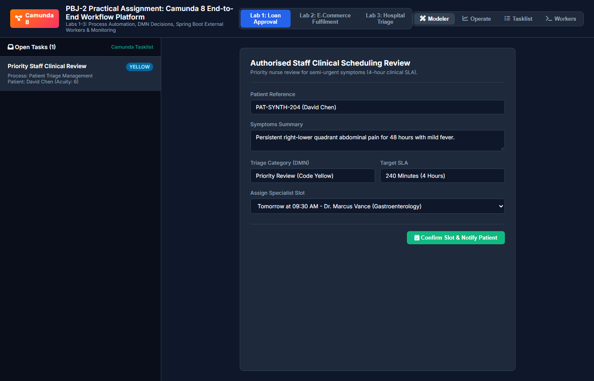
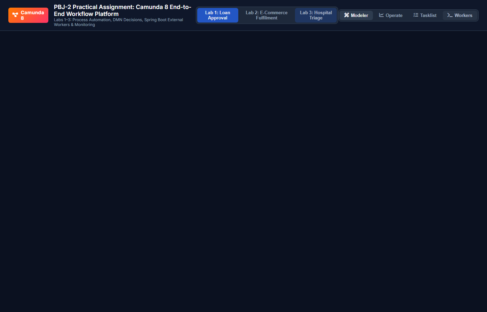

# Lab 3: End-to-End Hospital Appointment and Patient Triage Management

[](https://www.omg.org/spec/BPMN/2.0/)
[](https://www.omg.org/spec/DMN/1.3/)
[](https://camunda.com/)
[](https://spring.io/)

---

## 1. Executive Summary & Problem Statement
Healthcare appointment coordination and patient triage require robust, fault-tolerant orchestration that enforces strict clinical acuity guidelines, identifies life-threatening emergencies, coordinates outpatient consultation schedules, alerts clinical triage nurses, and safeguards system resilience during EHR downtime.

This lab delivers an end-to-end clinical triage and hospital appointment management workflow featuring:
- **BPMN 2.0 Patient Journey Orchestration** routing patients between emergency intake, clinical staff review, and straight-through automated booking.
- **Camunda DMN Decision Table** classifying patients into `"Urgent Assessment"`, `"Priority Review"`, or `"Routine"` based on predefined educational triage rules.
- **Spring Boot External Job Worker** validating synthetic patient intake details and symptoms narratives.
- **Camunda 8 REST Connector** interfacing with a simulated hospital scheduling microservice.
- **Camunda Tasklist Human Tasks** allowing authorized clinical staff review for priority patients, trauma emergencies, and waitlist capacity overrides.
- **Camunda Operate Monitoring** demonstrating incident diagnosis and recovery when scheduling services encounter transient downtime.

---

## 2. Process Architecture & Execution Flow

```
[Start: Appointment Requested]
          │
          ▼
[Task: Validate Patient Registration] (External Worker: patient-registration-validator)
          │
          ▼
   <Registration Valid?> ──(No)──► [Task: Notify Invalid Reg] ──► [End: Terminated]
          │ (Yes)
          ▼
[Task: Evaluate Predefined Triage (DMN)] (Called Decision: Decision_PatientTriage)
          │
          ▼
   <Triage Classification?>
          ├───────────────────────────────────────────────┐
          │ (Urgent Assessment)                           │ (Routine / Priority)
          ▼                                               ▼
[User Task: Immediate Emergency Assessment]    [Task: Query Scheduling REST API]
  (Tasklist Code Red Form)                       (REST Connector: io.camunda:http-json:1)
          │                                               │
          ▼                                               ▼
[End: Admitted for Immediate Intervention]       <Slot Availability & Triage?>
                                                          ├──────────────────────┬──────────────────────┐
                                                          │ (No Slots Available) │ (Priority Review)    │ (Routine Available)
                                                          ▼                      ▼                      ▼
                                              [User Task: Slot Override] [User Task: Priority]   [Task: Auto-Book Slot]
                                                (Tasklist Waitlist)        (Tasklist Nurse)       (External Worker)
                                                          │                      │                      │
                                                          ▼                      └──────────┬───────────┘
                                              [End: Patient Waitlisted]                     ▼
                                                                                [Task: Send Confirmation]
                                                                                            │
                                                                                            ▼
                                                                                [End: Appointment Confirmed]
```

### Participant Swimlanes:
1. **Automated Registration, Triage & Scheduling Engine**: Worker tasks (`patient-registration-validator`, `appointment-booking-worker`, `notification-service`), DMN rule evaluator, and Scheduling REST Connector.
2. **Authorised Clinical Staff & Emergency Team (Tasklist)**:
   - `Task_ImmediateHumanAssessment`: For acute, code-red clinical emergencies requiring trauma bay allocation.
   - `Task_PriorityStaffReview`: For semi-urgent cases requiring senior nurse review.
   - `Task_StaffSlotOverrideReview`: For capacity shortfalls and waitlist overrides.

---

## 3. DMN Decision Table Specification (`Decision_PatientTriage`)

- **Hit Policy**: `FIRST`
- **Inputs**:
  1. `urgencyScore` (`number`): Clinical acuity index on a scale from 1 (minimal) to 10 (life threatening).
  2. `symptomsSeverity` (`string`): Qualitative clinical descriptor (`"CRITICAL"`, `"ACUTE"`, `"MODERATE"`, `"MILD"`).
- **Outputs**:
  1. `triageCategory` (`string`): Derived band (`"Urgent Assessment"`, `"Priority Review"`, `"Routine"`).
  2. `targetResponseMinutes` (`number`): Statutory maximum clinical response SLA in minutes.
  3. `clinicalProtocol` (`string`): Documented educational clinical action directive.

| Rule # | Urgency Score (1-10) | Symptoms Severity | Triage Classification | Target Response | Clinical Protocol |
| :---: | :---: | :---: | :---: | :---: | :--- |
| **R1** | `>= 8` | `-` | `"Urgent Assessment"` | `15` min | Code Red: Immediate emergency human triage and trauma bay allocation |
| **R2** | `-` | `"CRITICAL", "ACUTE"` | `"Urgent Assessment"` | `15` min | Code Red: Acute symptom profile requires direct senior clinician assessment |
| **R3** | `[5..7]` | `-` | `"Priority Review"` | `240` min | Code Yellow: Priority nursing chart review and expedited slot allocation |
| **R4** | `-` | `"MODERATE"` | `"Priority Review"` | `240` min | Code Yellow: Semi-urgent clinical condition requires same-day specialist slot |
| **R5** | `-` | `-` | `"Routine"` | `2880` min (48h) | Code Green: Routine outpatient consultation queue within 48 hours |

---

## 4. Test Scenarios and Results

| Test Case ID | Test Scenario | Patient Inputs | Route Followed | Final Outcome | Status |
| :--- | :--- | :--- | :--- | :--- | :---: |
| **LAB3-TC-01** | Routine Request with Available Slot | Alex Morgan, Urgency: 2, Routine GP | Valid $\to$ DMN Routine $\to$ 3 Slots $\to$ Auto-Book $\to$ Confirmed | Appointment Confirmed | **PASSED** |
| **LAB3-TC-02** | Request Routed for Priority Staff Review | David Chen, Urgency: 6, Specialist | Valid $\to$ DMN Priority $\to$ Tasklist Staff Review $\to$ Confirmed | Appointment Confirmed | **PASSED** |
| **LAB3-TC-03** | Urgent Assessment Routed to Emergency | Evelyn Reed, Urgency: 9, Chest Pain | Valid $\to$ DMN Urgent $\to$ Tasklist Emergency Assessment $\to$ Admitted | Admitted Under Urgent Care | **PASSED** |
| **LAB3-TC-04** | No Appointment Slots Available | Liam Gallagher, Radiology MRI (0 slots) | Valid $\to$ DMN Routine $\to$ 0 Slots $\to$ Tasklist Waitlist Override | Placed on Waitlist | **PASSED** |
| **LAB3-TC-05** | Scheduling API Fails and Workflow Recovers | Sophia Taylor, Specialty `SIMULATE_500` | REST Connector 500 Incident in Operate $\to$ Diagnosed $\to$ Retried | Confirmed (Recovered) | **PASSED** |

---

## 5. Visual Evidence & Live Implementation Screenshots

All screenshots below were captured directly from the live running Camunda 8 implementation:

### A. Camunda Modeler Process & Decision Design
| BPMN 2.0 Process Diagram | DMN 1.3 Decision Table |
| :---: | :---: |
|  |  |

### B. Camunda Operate Monitoring & Incident Recovery
| Active Instance Token Flow & Variables | Incident Diagnostics & Variable Mutation Recovery |
| :---: | :---: |
|  |  |

### C. Camunda Tasklist & Spring Boot Worker Execution
| Clinical Triage Review Form (Tasklist) | Spring Boot External Worker Execution Logs |
| :---: | :---: |
|  |  |

---

## 6. Incident Recovery in Camunda Operate
During **LAB3-TC-05**, the mock hospital scheduling microservice simulates an unhandled 500 internal server error:
1. **Incident in Operate**: Camunda Zeebe halts the token at `Task_QueryAvailableSlotsRest` with status: `HTTP 500 Internal Server Error: Hospital Scheduling Database deadlocked`.
2. **Investigation**: In Operate, the administrator inspects the active incident, reviews the stack trace, and verifies network endpoints.
3. **Remediation**: The mock scheduling API service is restarted and confirmed healthy via its actuator endpoint.
4. **Resolution**: The administrator clicks **"Retry Incident"** in Operate. The job succeeds immediately, retrieves available slots, and completes the automated booking.

---

## 6. Assumptions and Limitations
- **Synthetic Patient Data**: All patient names, medical narratives, and IDs are strictly synthetic in compliance with privacy guidelines and HIPAA/GDPR simulated standards.
- **EHR Integration**: In this reference lab, scheduling data is served by a mock REST controller mimicking HL7 FHIR scheduling APIs.
